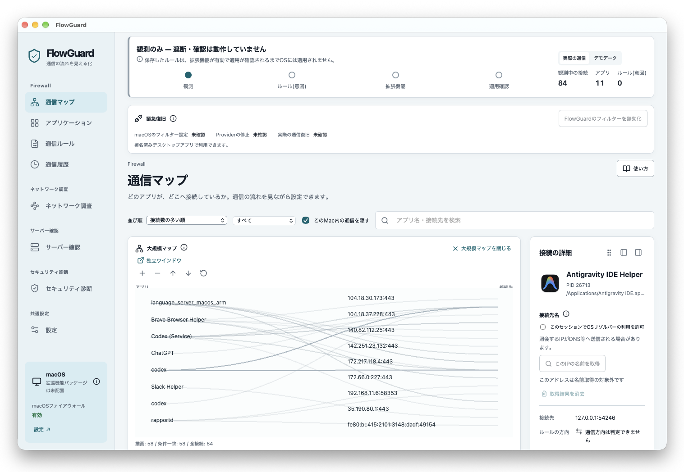

# FlowGuard for macOS



Macの通信を「アプリ → ルール → 接続先」で確認する、Tauri 2 + Rustのデスクトップアプリです。日本語・English・简体中文に対応しています。

**この0.1.0は観測・ルール管理版です。保存したルールはOSに適用されず、実際の遮断・許可確認は行いません。** macOS標準ファイアウォールの状態は読み取ります。OSの設定変更、管理者権限の取得、拡張機能のインストールは行いません。

## 起動

この環境で作成したアプリ:

`src-tauri/target/debug/bundle/macos/FlowGuard.app`

開発環境はNode.js 22.12以上、Rust、Xcode Command Line Tools、macOS 12以上を使用します。今回のビルド・実機検証はApple Silicon Macで行いました。

```sh
npm ci
npm run tauri dev
```

ブラウザだけでUIを試す場合:

```sh
npm run dev
```

`http://127.0.0.1:1420/` を開きます。ブラウザでは明示的にデモデータのみを表示します。実測データと共有状態はデスクトップ版のRustが所有します。

配布用ビルド:

```sh
npm run tauri build
```

別のMacへ配布する前にDeveloper ID署名と公証を行ってください。Network Extensionは現在のアプリバンドルには含まれていません。

## 操作

- 通信マップのアプリまたは接続先を選択し、右側のパネルでルールを保存します。保存後も「OS未適用」と表示します。
- 実際の通信では、現在のユーザーから見える確立済みTCP接続を5秒間隔で観測します。権限によって見える範囲が異なります。
- ソケット観測では通信開始方向を判定できないため、ルールの方向を明示的に選びます。許可・遮断・確認の線は「設定意図」を示します。
- 左／右へのドッキングと、詳細パネルの別ウインドウ表示に対応します。全ウインドウが同じRustの状態を購読します。
- ルール一覧でJSONを書き出し・読み込みできます。読み込みは一覧を置き換えますが、その場で取り消せます。バックアップには実行ファイルのパスと接続先が含まれます。
- 履歴はセッション内で最大500件。終了した接続のルール編集は行わず、現在も観測中の接続のみ詳細を開けます。
- 言語は右上から変更できます。

ルールと設定はTauriのアプリデータディレクトリに `document-v1.json` として保存します。macOSでは通常 `~/Library/Application Support/com.flowguard.desktop/` です。観測履歴はメモリにのみ保持します。ドメイン・国名・通信量・TLS内容は推測で追加しません。

## 構成

| 場所                        | 内容                                                                               |
| --------------------------- | ---------------------------------------------------------------------------------- |
| `src/components/`           | Reactの通信マップ、詳細パネル、履歴、設定、ルール管理                              |
| `src/core/store.ts`         | Rustのスナップショット購読とコマンド。ブラウザ用デモアダプター                     |
| `src-tauri/src/state.rs`    | Rust所有のDocument / Session、保存失敗時のロールバック                             |
| `src-tauri/src/observer.rs` | 固定の読み取り専用コマンド、実行ファイル識別、IPv4/IPv6パース                      |
| `src-tauri/src/renderer.rs` | Rust側の小規模マップのシーン情報                                                   |
| `src-tauri/src/gpu.rs`      | `gpu` featureのwgpu/Metal描画基盤。GPU上にテクスチャを保持                         |
| `native/FlowGuardFilter/`   | コンパイル可能なSwiftポリシーとNetwork Extension候補ソース。未接続・未インストール |
| `docs/ROADMAP.md`           | 完了・次工程・保留の区別                                                           |
| `docs/ARCHITECTURE.md`      | 観測と制御の境界、IPC、拡張機能の接続条件                                          |

小規模マップはWebViewのUI要素として表示します。大量描画用のwgpu基盤はMetalで動作確認済みですが、ネイティブ描画サーフェスと画面の接続は次工程です。フレームバッファや通信内容をJavaScriptへ転送するAPIはありません。

## 検証

```sh
npm run build
npm test
cargo test --manifest-path src-tauri/Cargo.toml --features gpu
swift test --package-path native/FlowGuardFilter
cargo run --manifest-path src-tauri/Cargo.toml --features gpu --example gpu_check
```

UIはネイティブ版とブラウザで確認し、320／375／414／768px幅でも検証しました。SwiftテストとGPUチェックは拡張機能の実際の遮断を検証するものではありません。拡張機能の実機試験は署名・権限・承認を備えたテスト環境で別途行います。

## English

FlowGuard visualizes established TCP connections and manages local firewall rule intentions. This build is **observation only**: saved rules do not enforce OS-level blocking or permission prompts. Run `npm ci` and `npm run tauri dev` for the desktop app, or `npm run dev` for the sample-data browser preview. Rust owns the shared document and session; the floating inspector subscribes to the same state. Signed Network Extension integration and native GPU presentation remain unfinished.

## 简体中文

FlowGuard将已建立的TCP连接可视化，并管理本地通信规则意图。当前版本**仅用于观测**：保存规则不会在系统中阻止通信，也不会弹出许可请求。运行 `npm ci` 和 `npm run tauri dev` 启动桌面应用，或运行 `npm run dev` 体验浏览器中的示例数据。Rust持有共享文档和会话状态，浮动详情面板订阅同一状态。经过签名的Network Extension集成及原生GPU画面呈现尚未完成。

### Network Extensionの署名なしパッケージ

`npm run tauri build -- --debug`の後、`npm run native:package`で拡張機能とSwiftホストブリッジを同梱した`native/build/FlowGuard.app`を生成できます。macOS 13以降用の検証パッケージです。署名・インストール・OS設定の変更は行いません。XPCの通信契約と更新処理は署名なしテストで検証していますが、実際の有効化・遮断は未実施です。詳細は[native/FlowGuardFilter/README.md](native/FlowGuardFilter/README.md)を参照してください。
